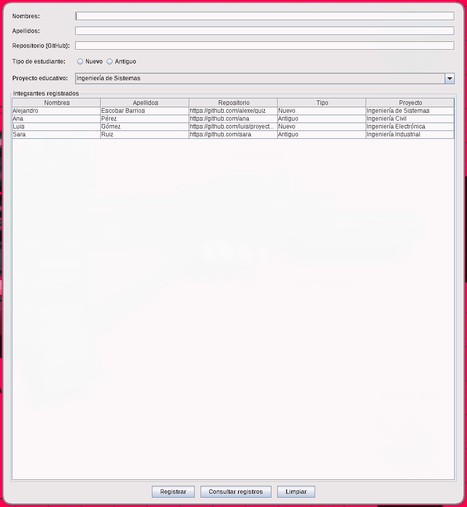

# Registro de Integrantes – Java Swing + MVC

Aplicación de escritorio para registrar a las personas que participan en proyectos educativos. Permite capturar los datos de cada integrante, validarlos, guardarlos en memoria y consultarlos en una tabla.

Proyecto de la asignatura **Programación Avanzada**.

**Autor:** Alejandro Escobar Barrios – 20251020094 – Universidad Distrital Francisco José de Caldas

## Objetivo

- Practicar la programación orientada a objetos (encapsulamiento, clases y objetos).
- Construir una interfaz gráfica con Java Swing.
- Separar responsabilidades con el patrón **MVC** (Modelo, Vista, Controlador).
- Usar colecciones (`ArrayList`) para almacenar registros en memoria.

## Requisitos

- **JDK 17 o superior** (probado con OpenJDK 21).
- Sistema operativo con entorno gráfico: Linux, Windows o macOS.
- Un IDE es opcional; la aplicación se compila y ejecuta desde la terminal.
- Sin librerías externas ni base de datos.

## Estructura del proyecto

```
RegistroIntegrantes/
├── src/
│   ├── model/
│   │   └── Integrante.java
│   ├── view/
│   │   └── FormularioIntegrante.java
│   ├── controller/
│   │   └── IntegranteController.java
│   └── Main.java
├── docs/
│   ├── explicacion-mvc.md
│   └── captura-ejecucion.png
├── .gitignore
└── README.md
```

## Ejecución

Desde la carpeta `RegistroIntegrantes/`:

```bash
# Compilar (genera las clases en out/)
javac -d out $(find src -name "*.java")

# Ejecutar
java -cp out Main
```

## Funcionalidades

1. **Registrar** un integrante con nombres, apellidos, URL del repositorio, tipo de estudiante (Nuevo o Antiguo) y proyecto educativo.
2. **Consultar registros**: muestra en la tabla todos los integrantes guardados durante la sesión.
3. **Limpiar**: vacía el formulario.

### Reglas de validación

- Nombres, apellidos y repositorio son obligatorios; los espacios al inicio y al final se ignoran.
- El repositorio debe ser una URL de GitHub: `https://github.com/usuario` o `https://github.com/usuario/repositorio` (también `http://`, y se admite una barra final).
- Debe seleccionarse un tipo de estudiante. Ningún tipo viene preseleccionado, para obligar al usuario a elegir.
- Si una validación falla, se muestra un mensaje indicando el campo y no se registra nada.

> Los datos viven solo en memoria: al cerrar la aplicación se pierden.

## Captura de pantalla



## Arquitectura MVC

| Capa | Clase | Función |
|---|---|---|
| Modelo | `model.Integrante` | Representa a un integrante con atributos privados. No conoce Swing. |
| Vista | `view.FormularioIntegrante` | Ventana Swing: captura datos, muestra mensajes y la tabla. No valida ni guarda. |
| Controlador | `controller.IntegranteController` | Recibe los eventos, valida, crea los `Integrante`, los guarda en un `ArrayList` y actualiza la vista. |

`Main` crea la vista, el controlador y muestra la ventana. La explicación detallada está en [`docs/explicacion-mvc.md`](docs/explicacion-mvc.md).
